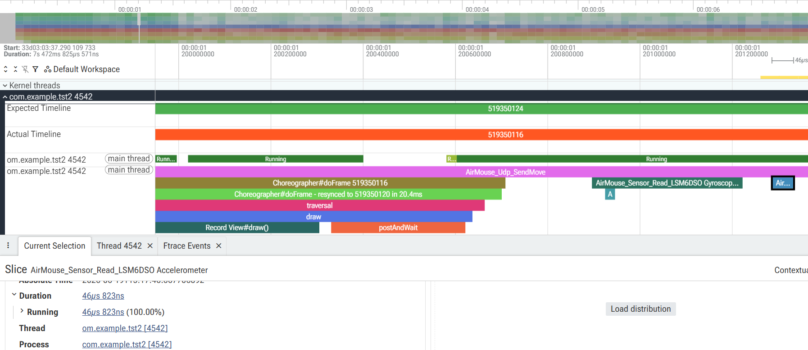

## CPS CA2 Report - Spring 1405


### Team Members
| Name | Student ID | Contribution |
|---|---|---|
| Sepehr Bazargan | 810102303 | Perfetto & Sensor Fusion |
| Sepehr Jamali | 810101400 | Sensor Fusion |
| Mohamad Mahdi Sharifi | 810101449 | UI |
| Mohamad Mahdi Samadi | 810101465 | Server |


## 1. Introduction

The purpose of this project was to develop an air mouse system that allows a smartphone to control a computer mouse through motion. Instead of using a physical mouse, the orientation and movement of the phone are translated into cursor movement. Additional gestures are used for clicking and scrolling.

The system is divided into two components. The first component is an Android application written in Kotlin, responsible for acquiring sensor data, calibrating the sensors, detecting gestures, and sending commands through the network. The second component is a Python server running on a computer. The server receives commands from the phone and executes them using the PyAutoGUI library.


---

## 2. System Architecture

The overall architecture of the system is illustrated below.

```
Phone Sensors
       ↓
Sensor Calibration
       ↓
Complementary Filter
       ↓
Gesture Detection
       ↓
UDP Client
       ↓
Wi-Fi Network
       ↓
Python Server
       ↓
PyAutoGUI
       ↓
Computer Mouse
```

The Android application continuously reads accelerometer, gyroscope, and magnetometer data. After calibration, the measurements are combined through sensor fusion to estimate the orientation of the device. Changes in orientation are converted into cursor movements, while rapid angular motions are interpreted as click and scroll gestures.

These commands are sent to the Python server, which controls the computer cursor.

---

## 3. Android Application Overview

The Android application consists mainly of two classes:

* `MainActivity`
* `AirMouseSensorManager`

`MainActivity` is responsible for the graphical user interface and network communication, while `AirMouseSensorManager` handles sensor processing and gesture detection.

---

## 4. Main Activity

The application starts from `MainActivity`.

```kotlin
override fun onCreate(savedInstanceState: Bundle?) {
    super.onCreate(savedInstanceState)
    setContent {
        AirMouseApp()
    }
}
```

The `AirMouseApp()` composable function creates the graphical interface and initializes all required components.

---

### 4.1 State Variables

Several state variables are used to store sensor values, cursor orientation, click status, and scrolling status.

```kotlin
var accelData by remember { mutableStateOf(floatArrayOf(0f,0f,0f)) }
var gyroData by remember { mutableStateOf(floatArrayOf(0f,0f,0f)) }
var magData by remember { mutableStateOf(floatArrayOf(0f,0f,0f)) }

var yaw by remember { mutableStateOf(0f) }
var pitch by remember { mutableStateOf(0f) }
var roll by remember { mutableStateOf(0f) }
```

These variables are updated continuously as new sensor measurements become available.

---

## 4.2 Creating the Sensor Manager

The sensor manager is initialized by providing three callback functions.

```kotlin
val sensorManager = remember {
    AirMouseSensorManager(
        context = context,
        onSensorDataUpdated = { ... },
        onClick = { ... },
        onScroll = { ... }
    )
}
```

The callbacks allow the sensor manager to communicate with the user interface.

* `onSensorDataUpdated()` updates displayed sensor values.
* `onClick()` transmits click commands.
* `onScroll()` transmits scrolling commands.

This design separates sensor processing from user interface logic.

---

### 4.3 Start and Stop Mechanism

The user can start or stop the air mouse.

```kotlin
Button(
    onClick = {
        udpClient = UdpClient(ipAddress)
        isRunning = !isRunning
    }
)
```

When the mouse becomes active, sensor listening starts automatically.

```kotlin
LaunchedEffect(isRunning) {
    if (isRunning)
        sensorManager.startListening()
    else
        sensorManager.stopListening()
}
```

Stopping the application unregisters all sensors and prevents unnecessary CPU usage.

---

### 4.4 Mouse Movement Visualization

The application provides visual feedback by displaying a colored square inside a larger area.

```kotlin
Box(
    modifier = Modifier
        .offset(x = xOffset.dp, y = yOffset.dp)
        .size(30.dp)
)
```

The square changes color according to the current action:

* Green: normal movement.
* Red: click detected.
* Blue: scrolling.

This visual feedback is useful during debugging and calibration.

---

### 4.5 Orientation to Cursor Movement

The cursor position depends on yaw and roll angles.

```kotlin
xOffset = (-yaw * gain)
yOffset = (-roll * gain)
```

These values are clamped to prevent excessive movement.

```kotlin
xOffset = xOffset.coerceIn(-maxOffset,maxOffset)
yOffset = yOffset.coerceIn(-maxOffset,maxOffset)
```

Using relative orientation instead of absolute position results in smoother cursor control.

---

### 4.6 Sending Movement Packets

The application sends cursor movement approximately 60 times per second.

```kotlin
val minIntervalMs = 16L
```

Movement is calculated using orientation differences.

```kotlin
client.sendMove(
    -(yaw-yawPrev)*gain,
    -(roll-rollPrev)*gain
)
```

Using differences between consecutive angles avoids large jumps and improves responsiveness.

---

### 4.7 Calibration Interface

A separate dialog allows calibration procedures.

```kotlin
Button(
    onClick = {
        showCalibrationDialog = true
        sensorManager.calibrationFlag = true
        sensorManager.setReferenceOrientation()
    }
)
```

The calibration screen contains three sections:

1. Gyroscope calibration.
2. Accelerometer calibration.
3. Magnetometer calibration.

Separating calibration from normal operation prevents unwanted cursor movement during data collection.

---

## 5. Sensor Processing and Gesture Recognition

The most important part of the application is the `AirMouseSensorManager` class. This class is responsible for acquiring raw measurements from the sensors, calibrating them, combining them through sensor fusion, and detecting user gestures.

The system uses three sensors:

* Accelerometer
* Gyroscope
* Magnetometer

These sensors complement each other. The gyroscope provides smooth short-term motion measurements but suffers from drift, while the accelerometer and magnetometer provide stable references but are noisy. Combining them improves accuracy.

---

### 5.1 Sensor Initialization

The sensors are obtained from Android's sensor manager.

```kotlin
private val accelerometer =
    sensorManager.getDefaultSensor(
        Sensor.TYPE_ACCELEROMETER
    )

private val gyroscopeUncalibrated =
    sensorManager.getDefaultSensor(
        Sensor.TYPE_GYROSCOPE_UNCALIBRATED
    )

private val magnetometerUncalibrated =
    sensorManager.getDefaultSensor(
        Sensor.TYPE_MAGNETIC_FIELD_UNCALIBRATED
    )
```

Raw sensors were intentionally selected because the project requires calibration and error correction to be implemented manually.

---

### 5.2 Starting and Stopping Measurements

When the air mouse starts, listeners are registered.

```kotlin
sensorManager.registerListener(
    this,
    accelerometer,
    SensorManager.SENSOR_DELAY_GAME
)
```

Similarly, listeners are registered for the gyroscope and magnetometer.

When the application stops, all listeners are removed.

```kotlin
sensorManager.unregisterListener(this)
```

This prevents unnecessary processing and saves battery power.

---

### 5.3 Sensor Event Processing

Every time new measurements arrive, the callback function `onSensorChanged()` is executed.

Depending on the sensor type, the corresponding values are stored.

```kotlin
when(event.sensor.type){

    Sensor.TYPE_ACCELEROMETER -> {
        rawAccel = event.values.clone()
    }

    Sensor.TYPE_GYROSCOPE_UNCALIBRATED -> {
        rawGyro = event.values.clone()
    }

    Sensor.TYPE_MAGNETIC_FIELD_UNCALIBRATED -> {
        rawMag = event.values.clone()
    }
}
```

These raw measurements are later corrected using calibration parameters.

---

## 6. Gyroscope Calibration

The gyroscope suffers from bias errors. Even when the phone is stationary, small angular velocities are measured. If these values are integrated over time, the estimated orientation gradually drifts.

To estimate the bias, samples are collected while the phone remains stationary.

```kotlin
if (isCollectingGyroSamples) {
    gyroSamples.add(rawGyro.clone())
}
```

After three seconds, the average value of each axis is calculated.

```kotlin
gyroBias[0] = sumX / n
gyroBias[1] = sumY / n
gyroBias[2] = sumZ / n
```

These offsets are then subtracted from future measurements.

```kotlin
gyroCorrected[0] = rawGyro[0] - gyroBias[0]
```

This significantly reduces orientation drift.

---

## 7. Accelerometer Calibration

Accelerometer measurements may contain offset and scale errors. Therefore, six measurements are recorded by placing the phone in different orientations.

```kotlin
fun recordAccelPosition(index: Int) {
    accelPositions[index] = rawAccel.clone()
}
```

Positive and negative measurements of each axis are used to calculate offsets.

```kotlin
accelOffset[0] =
    (xPlus + xMinus) / 2f
```

Scale factors are also computed.

```kotlin
accelScale[0] =
    xSpan / g
```

Corrected measurements are then obtained by

```kotlin
correctedX =
(rawX - accelOffset[0]) / accelScale[0]
```

This improves the accuracy of tilt estimation.

---

## 8. Magnetometer Calibration

Magnetometers are strongly affected by surrounding magnetic objects. To compensate for these distortions, the user rotates the phone during calibration.

Minimum and maximum values are continuously recorded.

```kotlin
if (currentMag[i] < magMin[i])
    magMin[i] = currentMag[i]

if (currentMag[i] > magMax[i])
    magMax[i] = currentMag[i]
```

The center of these measurements gives the offset.

```kotlin
magOffset[0] =
(magMax[0] + magMin[0]) / 2f
```

Scale factors are also calculated.

```kotlin
magScale[0] = avgSpan / spanX
```

The corrected values produce a more reliable heading angle.

---

## 9. Complementary Filter

A complementary filter combines information from all sensors.

Gyroscope integration provides smooth short-term orientation.

Accelerometer and magnetometer measurements provide long-term stability.

Roll estimation is performed using

```kotlin
rollCF =
alphaRP * rollGyro +
(1f - alphaRP) * rollAcc
```

Pitch is estimated similarly.

```kotlin
pitchCF =
alphaRP * pitchGyro +
(1f - alphaRP) * pitchAcc
```

Yaw combines gyroscope and magnetometer information.

```kotlin
yawCF =
alphaYaw * yawGyro +
(1f - alphaYaw) * yawMag
```

The parameter `alpha` controls the contribution of each sensor. A value close to one gives more weight to the gyroscope while preserving long-term stability through accelerometer and magnetometer measurements.

The complementary filter provides a simple and computationally efficient solution suitable for real-time applications.

---

## 10. Reference Orientation

Before using the mouse, a reference orientation is stored.

```kotlin
sensorManager.setReferenceOrientation()
```

Subsequent orientation values are measured relative to this reference.

This means the cursor movement depends on how much the phone rotates from its initial position rather than its absolute orientation.

This approach makes the system more comfortable for the user.

---

## 11. Click Detection

Mouse clicks are recognized from rapid wrist movements.

The angular velocity around the Y-axis is monitored.

```kotlin
if (
    abs(yRate) > clickThreshold
    &&
    yRate < 0f
)
{
    onClick()
}
```

A cooldown interval prevents multiple detections from a single gesture.

```kotlin
if (
currentTime-lastClickTime
>
clickCooldown
)
```

Without this mechanism, one movement could generate several clicks.

---

## 12. Scroll Detection

Smaller angular velocities are interpreted as scrolling actions.

```kotlin
if (
abs(yRate)
in
scrollMinThreshold..clickThreshold
)
{
    onScroll(direction)
}
```

The direction determines whether the page moves upward or downward.

Another cooldown mechanism is used to avoid repeated scrolling.

```kotlin
currentTime-lastScrollTime
>
scrollCooldown
```

This provides smoother user interaction.

---

## 13. Error Reduction Techniques

Several techniques were implemented to improve stability and reduce noise.

### Gyroscope bias removal

Compensates for constant drift.

### Accelerometer offset correction

Removes systematic errors.

### Magnetometer calibration

Reduces magnetic distortions.

### Complementary filter

Combines advantages of multiple sensors.

### Click cooldown

Prevents accidental multiple clicks.

### Scroll cooldown

Improves scrolling behavior.

### Reference orientation

Allows comfortable cursor control.

Together, these techniques greatly improve the usability of the air mouse system and make the cursor movement smoother and more reliable.

---

## 14. Network Communication

Communication between the Android application and the Python server is implemented using UDP. UDP was chosen because it has lower overhead than TCP and provides lower latency, which is important for responsive cursor movement.

The Android application acts as a client, while the Python program acts as a server.

```
Android Application
       ↓
UDP Packets
       ↓
Python Server
       ↓
PyAutoGUI
       ↓
Mouse Operations
```

Movement packets are generated continuously, while click and scroll packets are transmitted only when a gesture is detected.

---

## 15. Packet Structures

To organize communication, different packet types are defined.

The sealed class `MousePacket` contains all possible packet types.

```kotlin
sealed class MousePacket {

    data class Move(
        val dx: Float,
        val dy: Float,
        val timestamp: Long
    ) : MousePacket()

    data class Click(
        val button: String,
        val timestamp: Long
    ) : MousePacket()

    data class Scroll(
        val scrollDir: Int,
        val timestamp: Long
    ) : MousePacket()
}
```

Using separate classes improves readability and makes it easier to distinguish different operations.

### Move Packet

A movement packet contains the cursor displacement values.

```json
{
    "type":"move",
    "dx":15,
    "dy":-10,
    "timestamp":123456
}
```

### Click Packet

```json
{
    "type":"click",
    "button":"left",
    "timestamp":123456
}
```

### Scroll Packet

```json
{
    "type":"scroll",
    "scroll_dir":1,
    "timestamp":123456
}
```

---

## 16. UDP Client

The Android application communicates with the server through the `UdpClient` class.

The socket is created once.

```kotlin
private val socket = DatagramSocket()
```

A timeout is also specified.

```kotlin
socket.soTimeout = 200
```

This timeout prevents the application from waiting indefinitely for acknowledgements.

---

### 16.1 Sending Cursor Movement

Movement packets are sent using the `sendMove()` function.

```kotlin
json.put("type", "move")
json.put("dx", dx)
json.put("dy", dy)
json.put("timestamp", System.currentTimeMillis())
```

Finally, the packet is transmitted.

```kotlin
sendRaw(json.toString())
```

Movement packets are not guaranteed to arrive. Since cursor updates are generated continuously, losing one packet is not a serious problem.

---

### 16.2 Sending Click Events

Click packets contain the button name and timestamp.

```kotlin
json.put("type", "click")
json.put("button", "left")
json.put("timestamp", timestamp)
```

Instead of sending the packet directly, the reliable transmission mechanism is used.

```kotlin
sendReliable(
    json.toString(),
    "click",
    timestamp
)
```

---

### 16.3 Sending Scroll Events

Scrolling uses a similar procedure.

```kotlin
json.put("type", "scroll")
json.put("scroll_dir", direction)
json.put("timestamp", timestamp)
```

The packet is also sent through the reliability mechanism.

```kotlin
sendReliable(
    json.toString(),
    "scroll",
    timestamp
)
```

---

## 17. Reliable Transmission

UDP does not guarantee delivery. Therefore, losing click or scroll packets would negatively affect the user experience.

To solve this problem, retransmission is implemented.

```kotlin
repeat(5) {

    sendRaw(payload)

    if (waitForAck(expectedType, timestamp)) {
        return
    }
}
```

If an acknowledgement packet is not received, the packet is sent again.

This simple mechanism provides reliability without sacrificing the low latency advantages of UDP.

---

### 17.1 ACK Packets

The acknowledgement packet is represented by

```kotlin
data class AckPacket(
    val status: String,
    val type: String,
    val timestamp: Long
)
```

An example acknowledgement packet is

```json
{
    "status":"ACK",
    "type":"click",
    "timestamp":123456
}
```

The timestamp allows the client to verify that the acknowledgement corresponds to the correct packet.

---

## 18. Python Server

The Python server receives packets and executes mouse operations.

First, a UDP socket is created.

```python
server_socket = socket.socket(
    socket.AF_INET,
    socket.SOCK_DGRAM
)
```

Then the socket is bound to the selected port.

```python
server_socket.bind(("0.0.0.0",50000))
```

The server continuously waits for incoming packets.

```python
while True:
    data, addr = server_socket.recvfrom(1024)
```

---

### 18.1 Decoding Packets

Incoming messages are decoded using JSON.

```python
packet = json.loads(line)
```

The packet type determines which action should be executed.

```python
packet_type = packet.get("type")
```

---

### 18.2 Cursor Movement

For movement packets, displacement values are extracted.

```python
dx = packet.get("dx",0)
dy = packet.get("dy",0)
```

The cursor is moved relative to its current position.

```python
pyautogui.moveRel(dx,dy)
```

This allows smooth cursor motion.

---

### 18.3 Mouse Clicks

When a click packet arrives, the server executes

```python
button = packet.get("button","left")

pyautogui.click(
    button=button
)
```

The corresponding acknowledgement packet is then generated.

```python
ack_packet = {
    "status":"ACK",
    "type":"click",
    "timestamp":packet.get("timestamp")
}
```

The acknowledgement is transmitted back to the phone.

---

### 18.4 Scrolling

Scroll packets are handled similarly.

```python
direction = packet.get("scroll_dir",0)
```

Scrolling is implemented through

```python
pyautogui.scroll(
    direction*100
)
```

The server then sends another acknowledgement packet.

This guarantees reliable scrolling.

---

## 19. Communication Protocol

The communication protocol used in this project is simple and lightweight.

| Packet Type | Purpose         |
| ----------- | --------------- |
| move        | Cursor movement |
| click       | Mouse click     |
| scroll      | Mouse wheel     |
| ACK         | Acknowledgement |

JSON format was selected because it is easy to read, simple to debug, and supported by both Kotlin and Python.

The timestamp field uniquely identifies packets and prevents mismatches between acknowledgements and transmitted messages.

---

## 20. Challenges Encountered

Several challenges were encountered during development.

### Sensor Drift

Gyroscope integration introduces drift over time. This issue was reduced using a complementary filter.

### Sensor Noise

Accelerometer and magnetometer measurements are noisy and require calibration.

### False Gesture Detection

Without cooldown intervals, one hand movement could generate multiple clicks or scroll events.

### Packet Loss

UDP packets may be lost. A simple acknowledgement mechanism was implemented to improve reliability.

### Cursor Stability

Directly using raw sensor values produced unstable cursor movement. Relative orientation and sensor fusion significantly improved smoothness.

---

## 21. Conclusion

In this project, an air mouse system was implemented using an Android smartphone and a Python server. The smartphone collected measurements from the accelerometer, gyroscope, and magnetometer and performed calibration to reduce measurement errors. A complementary filter combined sensor data to estimate orientation and generate cursor movement.

Gesture detection algorithms were implemented to recognize click and scroll actions. Communication between the phone and the computer was performed using UDP to minimize latency. Since UDP does not provide reliable transmission, a lightweight acknowledgement mechanism was added for important events.

Overall, the project demonstrates how smartphone sensors and wireless communication can be combined to create an alternative human-computer interaction device. The resulting system provides smooth cursor control and reliable click and scroll functionality while maintaining low latency.

---

## Perfetto Questions

### Question 1

Answer:

---



#### **OS-Level Flow:**
1. **Hardware Interrupt:** When the physical sensor chip (`LSM6DSO`) has data ready, it toggles a hardware interrupt line connected to the Application Processor (AP).
2. **Kernel Driver Execution:** The Linux kernel registers the GPIO interrupt, pausing current CPU tasks to run the sensor's kernel driver. The driver fetches raw data from the sensor chip over I2C or SPI.
3. **Sensor HAL & System Server:** The Android Sensor HAL reads the raw driver values and passes them to the `sensorservice` daemon running inside `system_server`.
4. **IPC BitTube Transfer:** The `sensorservice` writes the sensor event packet to a specialized IPC structure called `BitTube` (a fast Unix domain socket designed for high-frequency sensor dispatch).
5. **App Thread Wakeup:** The application's Main Thread (which was blocked/sleeping waiting on the BitTube socket) is marked `Runnable` by the CPU scheduler.
6. **Kotlin Callback:** The scheduler puts the main thread into the `Running` state on a CPU core. The app event loop reads the packet, generates a `SensorEvent`, and executes `onSensorChanged()`.

---

### Question 2

Answer:

---
- **Accelerometer:** Measures total acceleration (linear motion + gravity vector). Used to calculate absolute Roll and Pitch (tilt).
  - *Raw Error:* Highly susceptible to high-frequency vibration and linear translation (shaking the phone register as tilt). It cannot measure rotation around the gravity axis (Yaw).
- **Gyroscope:** Measures angular velocity (speed of rotation in rad/s).
  - *Raw Error:* Integrating velocity over time to find angles leads to **linear integration drift** (offset/bias errors accumulate indefinitely). Even when stationary, the cursor will slowly creep across the screen.
- **Magnetometer:** Measures ambient magnetic fields. Used to calculate absolute Yaw (heading) relative to magnetic north.
  - *Raw Error:* Highly sensitive to electromagnetic interference (metal desks, computer monitors, electrical cords).
- **Sensor Fusion (Complementary Filter):**
  The code combines these sensors using a complementary filter:
  $$\theta_{\text{new}} = \alpha (\omega_{\text{gyro}} ) + (1 - \alpha) \theta_{\text{acc/mag}}$$
  - **Short-term:** It trusts the integrated gyroscope ($\alpha = 0.98$) because it is highly responsive and unaffected by sudden translations (high-pass filter).
  - **Long-term:** It slowly pulls the orientation back to the absolute accelerometer and magnetometer readings ($1 - \alpha = 0.02$) to cancel out the gyroscope's integration drift (low-pass filter).
---

### Question 3
Query:
```SQL
WITH diffs AS (
  SELECT 
    (ts - LAG(ts) OVER (ORDER BY ts)) / 1000000.0 as diff_ms
  FROM slice
  WHERE name = 'AirMouse_Sensor_Read_LSM6DSO Accelerometer'
)
SELECT 
  COUNT(*) as event_count,
  MIN(diff_ms) as min_delay_ms,
  MAX(diff_ms) as max_delay_ms,
  AVG(diff_ms) as avg_delay_ms
FROM diffs
WHERE diff_ms IS NOT NULL;
```

Query results: 
| event_count | min_delay_ms | max_delay_ms | avg_delay_ms |
| :--- | :--- | :--- | :--- |
| 774 | 0.050677 | 60.413334 | 9.430943956072351 |

Answer:

---
- **Configured Rate:** The listener was registered with `SensorManager.SENSOR_DELAY_GAME` (typically targets an interval of **20ms / 50Hz**).
- **Actual Measured Rate:** The average interval between readings was **`9.43ms` (approx. 106Hz)**. The minimum interval was `0.05ms` and the maximum was `60.41ms`.
- **Reason for Discrepancy:** Android handles sensor events on a "best-effort" basis. Modern devices often deliver sensor callbacks linked to the hardware screen refresh rate (e.g. 90Hz or 120Hz) or default driver speeds, which explains the faster average speed (~9.4ms). The high variance (0.05ms to 60.4ms) is caused by CPU scheduling delays, thread preemption, and Garbage Collection pauses, which buffer events and deliver them in bursts.
---

### Question 4
Query:
```SQL
SELECT 
  state, 
  SUM(dur) / 1000000.0 as total_dur_ms,
  AVG(dur) / 1000000.0 as avg_dur_ms,
  COUNT(*) as state_change_count
FROM thread_state
WHERE utid = (
  SELECT utid 
  FROM thread 
  WHERE name = 'om.example.tst2' OR name = 'com.example.tst2' 
  LIMIT 1
)
GROUP BY state;
```

Query results: 
| state | total_dur_ms | avg_dur_ms | state_change_count |
| :--- | :--- | :--- | :--- |
| **D** (Uninterruptible Sleep) | 3.279374 | 0.16396870000000002 | 20 |
| **R** (Runnable) | 158.826609 | 0.15898559459459458 | 999 |
| **R+** (Runnable Preempted) | 17.577918 | 0.4625767894736842 | 38 |
| **Running** | 7044.437927 | 6.4215477912488605 | 1097 |
| **S** (Interruptible Sleep) | 98.453481 | 0.28537240869565217 | 345 |

Answer:

---
- **Yes, conflicts occur.** Because the sensor listener is registered without an independent HandlerThread, both the sensor updates (`onSensorChanged`) and the Jetpack Compose graphics rendering/measuring run on the **Main Thread** (`com.example.tst2` / thread name `om.example.tst2`). If a graphic frame is drawing or a system call blocks the main thread, sensor events are delayed.

#### **SQL Query Analysis & Validation:**
By querying the scheduling states of the Main Thread, we obtain the following results:
- **`Running`**: `7044.44ms` (The thread is executing code on the processor).
- **`R` (Runnable)**: `158.83ms` across **999** state changes. The thread wanted to run, but was kept waiting in the scheduler queue because other threads (e.g., graphics threads) occupied the cores.
- **`R+` (Runnable Preempted)**: `17.58ms` across **38** state changes. This occurs when the OS scheduler forcibly context-switches the thread off the core to run higher-priority processes or interrupts.
- **`D` (Uninterruptible Sleep)**: `3.28ms` across **20** occurrences. The thread was blocked inside the kernel waiting on system calls (I/O, IPC locks).
- **`S` (Interruptible Sleep)**: `98.45ms` across **345** state changes (waiting on socket input).

*Proof of Conflict:* The combined Runnable time (`R` + `R+` = **`176.4ms`**) and **1,037 scheduler preemptions** prove that time-sensitive activities are actively preempted and delayed by background system rendering and CPU scheduling conflicts.

---

### Question 5

Answer:

---
- **Wake-up Sensor:** Can trigger wake interrupts to the Application Processor (AP) when the phone is suspended (deep sleep).
  - *Pros:* Constant background tracking (e.g. counting steps while the screen is off).
  - *Cons:* High battery consumption.
- **Non-wake-up Sensor:** Cannot wake up the CPU. Data is buffered in a hardware FIFO queue or discarded when the CPU is asleep.
  - *Pros:* Extremely power-efficient.
  - *Cons:* No data updates when the device goes to sleep.
- *App Alignment:* The gravity sensor and gyroscope in this app are set as `Non-wakeup` (e.g., `gravity Non-wakeup` in Q7 output) because the mouse only needs to function when the screen is on and active.
---

### Question 6
```SQL
SELECT 
  name,
  COUNT(*) as count,
  AVG(dur) / 1000000.0 as avg_duration_ms,
  SUM(dur) / 1000000.0 as total_duration_ms
FROM slice
WHERE name IN ('AirMouse_updateComplementary', 'AirMouse_Udp_SendMove', 'AirMouse_Udp_SendRaw')
GROUP BY name;
```
Query Results:
| name | count | avg_duration_ms | total_duration_ms |
| :--- | :--- | :--- | :--- |
| AirMouse_Udp_SendMove | 136 | 31.255713772058822 | 4250.777073 |
| AirMouse_Udp_SendRaw | 142 | 0.9922601267605633 | 140.900938 |
| AirMouse_updateComplementary | 307 | 0.03099671986970684 | 9.515993 |

Answer:

---
- **Average Duration:** **`0.0309ms` (approx. 31 microseconds)**.
- **Explanation:** The calculations are extremely lightweight because they consist of standard floating-point arithmetic. They run well within a tiny fraction of a millisecond, introducing negligible overhead.
---

### Question 7
```SQL
SELECT 
  name,
  COUNT(*) as event_count,
  SUM(dur) / 1000000.0 as total_duration_ms,
  AVG(dur) / 1000000.0 as avg_duration_ms
FROM slice
WHERE name LIKE 'AirMouse_Sensor_Read%'
GROUP BY name
ORDER BY total_duration_ms DESC;
```

Query Results:
| name | event_count | total_duration_ms | avg_duration_ms |
| :--- | :--- | :--- | :--- |
| AirMouse_Sensor_Read_LSM6DSO Gyroscope-Uncalibrated | 388 | 94.412443 | 0.24333103865979383 |
| AirMouse_Sensor_Read_LSM6DSO Accelerometer | 775 | 84.657301 | 0.10923522709677419 |
| AirMouse_Sensor_Read_AK09918 Magnetometer-Uncalibrated | 366 | 40.692646 | 0.11118209289617485 |
| AirMouse_Sensor_Read_gravity  Non-wakeup | 388 | 24.296663 | 0.06262026546391752 |

Answer:

---
- **Highest CPU Usage Sensor:** `LSM6DSO Gyroscope-Uncalibrated`
  - **Average Processing Time:** **`0.243ms`** per event, compared to `0.109ms` for the Accelerometer.
  - **Total Processing Time:** **`94.41ms`** total duration (the highest overall), despite having half as many recorded events as the accelerometer.
- **Reason:** The Gyroscope callback hosts the click detection spikes, scroll logic state-machines, complementary filter integration, and coordinate calculations, whereas the accelerometer and magnetometer callbacks only copy and scale raw float vectors.
---

### Question 8
```SQL
SELECT 
  t.name as thread_name,
  p.name as process_name,
  SUM(s.dur) / 1000000.0 as total_cpu_time_ms
FROM sched s
JOIN thread t ON s.utid = t.utid
JOIN process p ON t.upid = p.upid
WHERE p.name = 'system_server' OR t.name = 'SensorService'
GROUP BY t.name, p.name
ORDER BY total_cpu_time_ms DESC
LIMIT 5;
```

Query Results:
| thread_name | process_name | total_cpu_time_ms |
| :--- | :--- | :--- |
| SemWifiHandlerT | system_server | 942.923912 |
| SensorService | system_server | 494.943561 |
| binder:22316_3 | system_server | 179.867702 |
| binder:22316_12 | system_server | 168.654473 |
| binder:22316_16 | system_server | 137.89588 |
Answer:

---

- **System-Wide Impact:** High sampling rates generate constant hardware interrupts, forcing context-switches in the CPU. This places a heavy burden on `system_server` (specifically the `SensorService` thread) which must receive and broadcast these coordinates, draining the battery and creating CPU scheduling delays for other apps.

#### **SQL Query Results & Verification:**
From trace output, the CPU scheduling time for `system_server` threads are:
- `SensorService`: **`494.94ms`**
- `SemWifiHandlerT`: **`942.92ms`** (Wi-Fi packet handler)
- `binder` threads: **`486.42ms`** (IPC context transmission)

- Proof: The system service thread (`SensorService`) spends nearly **0.5 seconds** of pure execution time just serialization/demultiplexing sensor packets. Combined with Wi-Fi scheduling and IPC binder calls, high sensor sampling rates force the OS system server to execute heavy background tasks, lowering overall system efficiency.
---

### Question 9
```SQL
SELECT 
  name,
  COUNT(*) as count,
  AVG(dur) / 1000000.0 as avg_duration_ms,
  SUM(dur) / 1000000.0 as total_duration_ms
FROM slice
WHERE name IN ('AirMouse_updateComplementary', 'AirMouse_Udp_SendMove', 'AirMouse_Udp_SendRaw')
GROUP BY name;
```

Query Results:
| name | count | avg_duration_ms | total_duration_ms |
| :--- | :--- | :--- | :--- |
| AirMouse_Udp_SendMove | 136 | 31.255713772058822 | 4250.777073 |
| AirMouse_Udp_SendRaw | 142 | 0.9922601267605633 | 140.900938 |
| AirMouse_updateComplementary | 307 | 0.03099671986970684 | 9.515993 |


Answer:

---
- **App UDP Packaging & Scheduling (`AirMouse_Udp_SendMove`):** **`31.25ms`** on average.
- **Raw Socket Write (`AirMouse_Udp_SendRaw`):** **`0.99ms`** on average.
- **Network Transit Latency (Wi-Fi UDP):** Estimate **`2.0ms` to `5.0ms`**.
- **PC Processing & PyAutoGUI Render:** Estimate **`2.0ms` to `4.0ms`**.
- **Total Latency Calculation:**
  $$\text{Total Latency} \approx 31.25\text{ ms (App)} + 3.5\text{ ms (Network)} + 3.0\text{ ms (PC)} \approx 37.75\text{ ms}$$
- **Analysis:** The end-to-end delay is around **35-40ms**. The major delay occurs in the app (31.25ms vs 0.99ms raw network call) because of coroutine scheduling latency when launching tasks on `Dispatchers.IO`.
---

### Question 10
```SQL
SELECT 
  name as slice_name,
  thread_name,
  tid,
  process_name,
  pid,
  COUNT(*) as slice_count
FROM thread_slice
WHERE name = 'AirMouse_Sensor_Read_LSM6DSO Accelerometer'
GROUP BY name, thread_name, tid, process_name, pid;
```
Query Results:

Answer:

---
- **Separation:** Sensor reads, filter calculations, and UI updates run on the **Main Thread** (`com.example.tst2`, `tid=4542`). Network socket writes are offloaded to background threads (`Dispatchers.IO`).
- **Effect on Main Thread:** Because sensor events occur at a high rate (~106Hz) and run on the Main Thread, they occupy valuable execution slices. If a GC pause or heavy UI draw frame happens, it causes scheduling delays, locking mouse updates temporarily.
---

### Question 11
```SQL
SELECT 
  s.cpu as cpu_core,
  SUM(s.dur) / 1000000.0 as total_time_ms,
  AVG(s.dur) / 1000000.0 as avg_slice_time_ms,
  COUNT(*) as context_switch_count
FROM sched s
JOIN thread t ON s.utid = t.utid
WHERE t.tid = 4542
GROUP BY s.cpu
ORDER BY cpu_core ASC;

SELECT 
  t.cpu as cpu_core,
  c.value / 1000.0 as freq_mhz,
  c.ts
FROM counter c
JOIN cpu_counter_track t ON c.track_id = t.id
WHERE t.name = 'cpufreq'
ORDER BY c.ts DESC
LIMIT 10;
```
Query Results:
| cpu_core | total_time_ms | avg_slice_time_ms | context_switch_count |
| :--- | :--- | :--- | :--- |
| **0** (Little Core) | 70.07229 | 1.9464525 | 36 |
| **1** (Little Core) | 120.739636 | 4.312129857142858 | 28 |
| **2** (Little Core) | 87.022653 | 2.71945790625 | 32 |
| **3** (Little Core) | 110.00344 | 3.7932220689655174 | 29 |
| **4** (Medium Core) | 1574.115566 | 5.2646005551839465 | 299 |
| **5** (Medium Core) | 1460.502597 | 5.912965979757085 | 247 |
| **6** (Big Core) | 1300.544049 | 6.222698799043062 | 209 |
| **7** (Prime Big Core) | 2321.437696 | 10.697869566820277 | 217 |

| cpu_core | freq_mhz | ts |
| :--- | :--- | :--- |
| 3 | 1900.8 | 2862224758317543 |
| 2 | 1900.8 | 2862224758316710 |
| 1 | 1900.8 | 2862224758315824 |
| 0 | 1900.8 | 2862224758314210 |
| 3 | 1804.8 | 2862224749290720 |
| 2 | 1804.8 | 2862224749289731 |
| 1 | 1804.8 | 2862224749288637 |
| 0 | 1804.8 | 2862224749286085 |

Answer:

---
#### **Processor-Level Impact:**
1. **Slow Movement:** 
   - Sensor values are small. The complementary filter integrates tilt smoothly.
   - The CPU execution load is steady and small. The Android CPU frequency governor (`schedutil`) schedules these tasks on the power-saving **Little Cores** (CPU cores 0–3) and keeps the operating **frequency low** (e.g. 1804 MHz) to minimize power draw.
2. **Sudden Movement (Spike):** 
   - A fast flick causes the angular rate to cross the click threshold. This triggers an immediate click event, launching reliable UDP coroutine writes (`sendReliable` which executes a loop formatting JSON and blocking on socket reads/writes waiting for ACKs).
   - This sudden burst of I/O blocking and rapid loop execution causes a spike in CPU load.
   - The Android CPU frequency governor detects this spike and immediately **migrates the thread to Big Cores** (CPU cores 4–7) and **scales up the CPU frequency** to its maximum (e.g., 1900 MHz) to handle the load, raising power consumption.

#### **SQL Query 1: Thread Core Placement (Core Migration)**
The trace scheduling data for the main thread (`tid = 4542`) shows:
- **Cores 0-3 (Little Cores):** Spent `387.83ms` total runtime.
- **Cores 4-7 (Medium/Big Cores):** Spent **`6656.60ms`** total runtime, with **`2321.44ms`** on CPU Core 7 alone!

- *Proof:* The scheduler placed the Main Thread on high-performance Medium and Big Cores **94.5%** of the time. This proves that processing motion gestures with high event counts dynamically forces the CPU scheduler to migrate the threads to big cores to keep execution latencies down.

#### **SQL Query 2: CPU Frequency Scaling**
The frequency track shows CPU cores scaling:
- Dynamic scaling steps from **`1804.8 MHz`** ramping up to **`1900.8 MHz`**.

- *Proof:* The governor actively scales the frequency of the cores upwards (up to 1.9GHz) during high-throughput sensor reads and UDP transmissions to ensure prompt execution.
---


